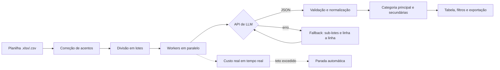

# Classificador de Observações de Produção com LLMs

Ferramenta que lê observações em texto livre (planilha `.xlsx`/`.csv`) e as classifica automaticamente em categorias configuráveis usando modelos de linguagem (LLMs), com **saída estruturada em JSON validada**, **processamento em lotes concorrentes**, **fallback em falhas** e **controle de custo em tempo real**.


> **Protótipo de validação.** A interface web foi criada para facilitar os testes e a validação da classificação. O uso previsto é a **integração automática ao fluxo de dados**, classificando cada registro assim que ele é lançado no sistema, sem interface. A lógica principal (prompt, validação do JSON, fallback e controle de custo) está em [`src/classifier.js`](src/classifier.js), independente da tela.

## Por que existe

Observações de produção escritas pelos operadores costumam ficar sem classificação. Classificar à mão leva tempo (estimativa conservadora de 10 a 15 segundos por registro), e o resultado é que a informação acaba descartada, apesar de ser útil para identificar gargalos e priorizar ações (por exemplo, em análises de Pareto). Esta ferramenta automatiza essa etapa.

Projeto desenvolvido em um contexto acadêmico-profissional (FACAMP) com uma empresa industrial parceira. **As categorias, os dados e as planilhas reais não fazem parte deste repositório**; as categorias e os dados de exemplo aqui são fictícios.

## Resultados em testes

| Métrica | Resultado |
|---|---|
| Acurácia | ~90% nos testes realizados |
| Tempo para 1.000 linhas | menos de 2 minutos |
| Referência manual | ~3 horas (10 a 15 s por registro, estimativa conservadora) |

Os testes usaram bases reais da empresa parceira, com mais de 25 mil registros no conjunto de estudos. Os números não foram reproduzidos com os dados de exemplo deste repositório.

## Funcionalidades

- **Categoria principal e secundárias** por observação, com **ordem de prioridade** editável (arrastar e soltar) para desempate.
- **Vários provedores e modelos:** Groq, OpenRouter e Jev (TypeSafe), configurados em [`src/providers.js`](src/providers.js).
- **Saída estruturada em JSON:** tenta primeiro *tool/function calling* e, se o modelo não aceitar, usa JSON em texto livre. A resposta é validada e normalizada antes de ser usada.
- **Lotes e concorrência:** várias observações por requisição (20 a 50) e 1 a 5 *workers* em paralelo.
- **Fallback em cascata:** se um lote falha, divide em sub-lotes e, por fim, tenta linha a linha.
- **Controle de custo:** estimativa antes de rodar, consumo real de tokens em tempo real e **parada automática** se o gasto passar de um teto de segurança.
- **Disjuntor de falhas:** interrompe o processamento após falhas consecutivas, que indicam um problema sistêmico.
- **Correção de acentos corrompidos** (mojibake) em planilhas exportadas de outros sistemas.
- **Interface completa:** estatísticas, filtro por categoria, busca, paginação e exportação para `.xlsx` ou `.csv`.

## Como funciona



Decisões de projeto para economizar tokens e aumentar a confiabilidade (detalhadas nos comentários de [`src/classifier.js`](src/classifier.js)):

1. **Classificação em lote:** o prompt de sistema é enviado uma vez por lote, não por linha.
2. **Saída mínima:** o modelo responde com IDs numéricos de categoria, não com os nomes.
3. **Formato forçado:** `tool calling` ou `response_format: json_object`, para evitar texto fora do JSON.
4. **`max_tokens` dinâmico:** calculado pelo tamanho do lote, como teto de segurança.
5. **Fallback só quando necessário:** sub-lotes e linha a linha apenas se o lote inteiro falhar.
6. **`temperature: 0`:** respostas mais estáveis e reproduzíveis.

No **Jev**, o fluxo é diferente: cada linha vira uma requisição com uma pergunta sim/não (com probabilidade) por categoria, e a ordem de prioridade decide a categoria principal quando mais de uma passa do limiar.

## Como usar

1. Abra o `index.html` no navegador (é necessária conexão com a internet para carregar a biblioteca SheetJS e as fontes) ou use a versão publicada no GitHub Pages.
2. Escolha o provedor e o modelo e cole a sua **chave de API** (use o botão *Testar chave de API* para conferir).
3. Carregue uma planilha, por exemplo [`examples/observacoes_exemplo.csv`](examples/observacoes_exemplo.csv), e escolha a coluna com as observações.
4. Ajuste as categorias e a ordem de prioridade, e, se quiser, acrescente uma frase de contexto curta (ela é enviada em cada requisição, então seja direto).
5. Confira a **estimativa de custo**, clique em **Processar** e acompanhe o custo em tempo real.
6. Filtre os resultados e **exporte** para Excel ou CSV.

## Privacidade e segurança

- A chave de API fica **apenas na memória do navegador**, não é gravada em disco nem enviada a outro servidor além do provedor escolhido.
- As chamadas são feitas **direto do navegador** para o provedor. Isso serve para um protótipo; em um sistema real, as chamadas devem passar por um **back-end** que guarda as chaves.
- O texto das observações é **enviado a APIs de terceiros**. Não use dados confidenciais sem autorização da organização e verifique as políticas de retenção de dados de cada provedor.
- Defina um limite de gasto mensal na conta do provedor (por exemplo, no OpenRouter).

## Estrutura do projeto

```
├── index.html            # interface
├── src/
│   ├── styles.css
│   ├── config.js         # categorias, prioridade e estado global
│   ├── providers.js      # provedores, endpoints e modelos (preços de referência)
│   ├── utils.js          # correção de acentos e escape de HTML
│   ├── classifier.js     # prompts, chamadas às APIs, validação, fallback e workers
│   ├── ui.js             # controles, estimador de custo e leitura de planilhas
│   └── app.js            # botão Processar, tabela de resultados e exportação
├── examples/
│   └── observacoes_exemplo.csv   # dados fictícios
└── docs/
    └── screenshot.png
```

Os scripts são carregados em ordem pelo `index.html` e compartilham o escopo global (sem *bundler* nem dependências de build).

## Personalização

- **Categorias e prioridade:** pela interface, ou em `src/config.js`.
- **Modelos e preços:** em `src/providers.js`. Os preços são valores de referência e mudam com frequência.

## Limitações e próximos passos

- Validar a acurácia com um conjunto rotulado por mais de uma pessoa, medindo também a concordância entre os rótulos humanos.
- Transformar a lógica de `classifier.js` em um serviço (API) que classifique cada registro no momento do lançamento.
- Adicionar testes automatizados (validação de JSON, fallback e teto de custo).
- Registrar métricas de uso (latência, taxa de fallback e custo por 1.000 linhas).

## Autor

**Pedro Dorighello Bertuzzi** — Engenharia da Computação, FACAMP.
[LinkedIn](https://www.linkedin.com/in/pedrodbertuzzi/) · [GitHub](https://github.com/b3rtuzz1)

## Licença

[MIT](LICENSE)

---

## English summary

A browser-based prototype that classifies free-text production notes (from `.xlsx`/`.csv`) into configurable categories using LLMs. It focuses on reliability and cost control: validated structured JSON output, concurrent batching, cascading fallback, real-time cost tracking and an automatic cost-safety stop. In tests it reached ~90% accuracy and classified 1,000 rows in under 2 minutes versus an estimated ~3 hours manually (10–15 s per record). The web UI is a validation prototype; the intended use is an automatic integration into the production data flow. All categories and example data in this repository are fictional. Open `index.html`, paste your own API key (Groq, OpenRouter or Jev) and load `examples/observacoes_exemplo.csv` to try it.
